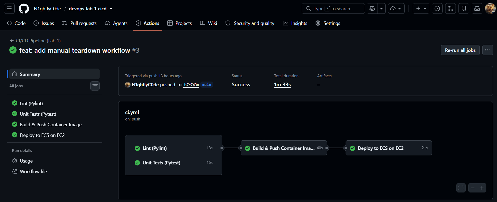
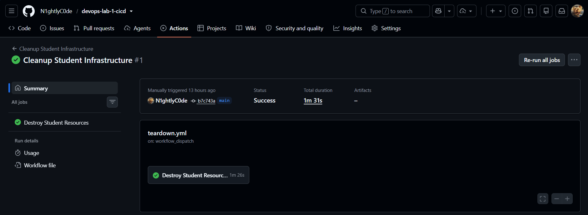
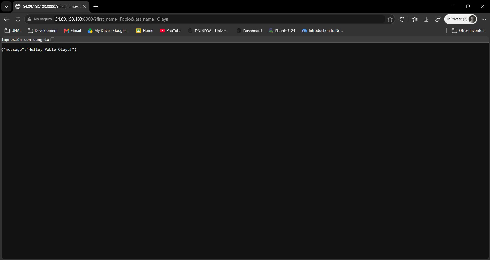

# Laboratorio 01: CI/CD con GitHub Actions y Amazon ECS

## 1. Arquitectura de Contenedores y Conceptos de CI/CD

### Arquitectura de Contenedores

La aplicación FastAPI funciona dentro de un contenedor Docker, lo cual garantiza que se ejecute de manera uniforme en cualquier entorno. El contenedor parte de una imagen base ligera (`python:3.12-slim`), que reduce tanto el tamaño de la imagen como los tiempos de despliegue.

Una vez construida, la imagen reside en un repositorio privado de **Amazon ECR (Elastic Container Registry)**, donde se almacena de forma segura. Desde allí, **AWS ECS (Elastic Container Service)** actúa como orquestador y despliega el contenedor sobre una instancia **Amazon EC2** de tipo `t3.micro`. Esta instancia es administrada por un **Auto Scaling Group**, que proporciona la base para la alta disponibilidad y la escalabilidad de la infraestructura.

### Conceptos de CI/CD Aplicados

**GitHub Actions** permite automatizar el ciclo de vida del software y se activa cada vez que hay cambios en la rama `main`:

- **Integración Continua (CI):** Cada vez que se sube código, el pipeline verifica su calidad mediante un análisis estático (linter) con `pylint`, y comprueba que la lógica no esté rota por medio de pruebas unitarias (ejecutadas con `pytest`).
- **Despliegue Continuo (CD):** Cuando el código supera las pruebas, el pipeline construye de forma automática la nueva imagen Docker y la publica en Amazon ECR. Después, ejecuta un script de despliegue que actualiza el servicio en el clúster ECS, de modo que la nueva versión del contenedor queda en ejecución sobre la instancia EC2.

---

## 2. Ejecución del Pipeline de GitHub Actions

### Pipeline Automático de Despliegue

El archivo `ci.yml` define el pipeline de integración y despliegue continuo. Este pipeline tiene cuatro etapas: *Lint*, *Unit Tests*, *Build & Push* y *Deploy to ECS on EC2*. En la Imagen 1 se observa que las cuatro etapas finalizan correctamente.

**Imagen 1.** Ejecución exitosa de las cuatro etapas del pipeline de integración y despliegue continuo.

### Pipeline Manual de Eliminación de Infraestructura

Para evitar el consumo innecesario de recursos, el archivo `cleanup.yml` define un flujo de trabajo manual que elimina todos los componentes aprovisionados: el servicio ECS, el Auto Scaling Group, el clúster, el Security Group y el repositorio ECR.

**Imagen 2.** Ejecución del pipeline manual para eliminar la infraestructura.

---

## 3. Petición HTTP a la IP Pública de la Instancia EC2

Al enviar una petición HTTP al endpoint de la aplicación, usando la IP pública asignada a la instancia EC2, la API de FastAPI responde correctamente con el formato JSON esperado: `{"message": "Hello, TuNombre TuApellido!"}`. Esto confirma que el contenedor está en ejecución y que el servicio es accesible desde internet.

**Imagen 3.** Petición HTTP a la IP pública de la instancia EC2 desde el navegador.

---

## 4. Propuestas para Mejorar el Pipeline

- **Etiquetado de imágenes con el SHA del commit:** Cuando el despliegue depende de una etiqueta mutable como latest, cada nueva publicación sobrescribe la anterior. Esto impide saber con exactitud qué versión del código se ejecuta en producción y dificulta volver a una versión estable si un despliegue falla. Publicar cada imagen en Amazon ECR con el identificador del commit que la originó facilitaría el rollback, ya que basta con apuntar el servicio ECS a la etiqueta de una versión anterior.
- **Escaneo de vulnerabilidades en la imagen:** Las cuatro etapas del pipeline (Lint, Unit Tests, Build & Push y Deploy) verifican el estilo y la lógica del código, pero ninguna revisa la seguridad de la imagen. Por lo tanto, una librería de Python o un paquete del sistema con vulnerabilidades conocidas puede llegar a producción sin ser detectado. Añadir una etapa que analice la imagen antes de publicarla, ya sea con el escaneo nativo de Amazon ECR o con otra herramienta, permitiría detener el despliegue cuando encuentra fallos críticos y así incorpora la seguridad desde la etapa de construcción.
- **Cobertura mínima de pruebas:** La etapa Unit Tests ejecuta pytest y confirma que las pruebas existentes pasan, pero no mide qué porción del código está realmente cubierta. Por lo tanto, el pipeline puede aprobar un cambio aunque gran parte de la lógica nueva no tenga ninguna prueba. Agregar pytest-cov y definir un porcentaje mínimo de cobertura (por ejemplo, 80 %) hace que el pipeline falle cuando el código nuevo no se prueba lo suficiente, lo cual mejora la confianza en cada despliegue con un cambio de una sola línea de configuración.